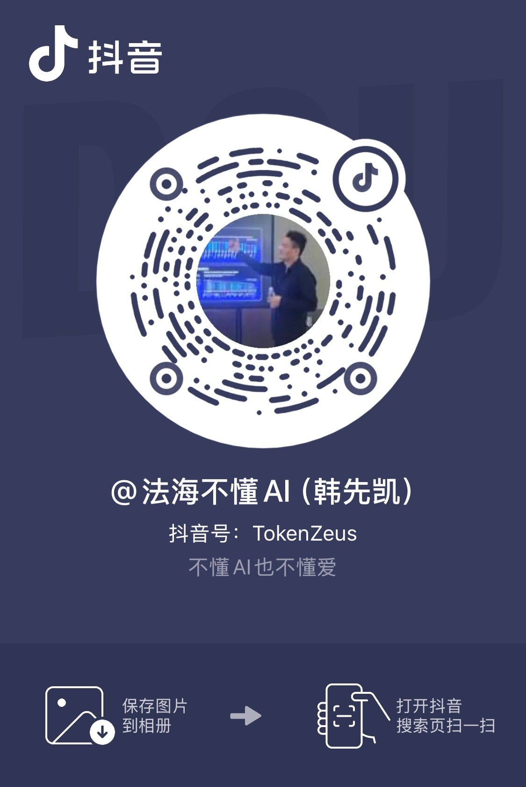

# 人生レベルアップガイド

[中文](https://byoungd.github.io/up/) | [English](docs/en/README.md) | 日本語

**著者 Han Xiankai、ペンネーム「Li Pu」。**

**AI 時代の生涯学習ガイドです。**

多くの人は、人生を変えるための「まっさらな 1 時間」が来るのを待っています。この忙しい時期が終わったら、英語が上達したら、お金が入ったら、恐れがようやく和らいだら、と。けれども人生がそんな 1 時間をくれることはめったにありません。ほとんどの変化は、片付いていない一日のただ中から始まります。

この継続的に更新される書稿は、2017 年に英語学習ガイドとして始まりました。かつて英語は地図のすべてでしたが、今ではより広い家へと通じる大切な扉のひとつになっています。その先には、AI 学習、実際のプロジェクト、ビジネスの実験、人間関係、失敗、そして回復があります。この本はまっすぐな上り坂を約束しません。代わりに、何度でも戻ってこられる工房を差し出します。現実の問題を持ち込み、自分が立っている足元を確かめ、やり遂げられるほど小さな行動をひとつ試し、その結果を生活に持ち帰ってください。

助けを受けるに値するほど賢いことや自律していることを、先に証明する必要はありません。一度に本を読み終える必要もありません。AI は説明し、比較し、作業を分解してくれるかもしれませんが、判断、境界、責任はあなたのものです。ここにあるのは成功の公式ではなく、行動、失敗、回復、そして再出発によって試されてきた記録です。

**得られるもの:** 中英バイリンガルのオープン書稿、ダウンロード可能な EPUB/PDF 版、再利用できるワークシート、そして 5 分から始まり、章に応じて再テストし、90 日後により大きな仕組みを振り返る実践のリズムです。

  継続的に更新される書稿
  <a href="./docs/en/book-downloads.md">ダウンロードセンター</a>
  <a href="./docs/public/downloads/life-level-up-guide-en.epub" download>Download English EPUB</a>
  <a href="./docs/public/downloads/life-level-up-guide-zh.epub" download>下载中文 EPUB</a>
  <a href="./docs/public/downloads/life-level-up-guide-en.pdf" download>Download English PDF</a>
  <a href="./docs/public/downloads/life-level-up-guide-zh.pdf" download>下载中文 PDF</a>
  <a href="https://github.com/byoungd/up">ソースと正誤表</a>
  <a href="./docs/en/templates/reader-field-note.md">読者フィールドノート</a>
  <a href="https://github.com/byoungd/up/blob/main/CITATION.cff">引用形式</a>
  <a href="https://creativecommons.org/licenses/by-nc/4.0/">本文 CC BY-NC 4.0</a>

  

    ここから始める
    <h2 id="quick-start-title">まずひとつ行動し、それからどこまで読むかを決める</h2>
    
初めての訪問で本全体を抱え込む必要はありません。今日の状況に合う入口を選び、小さなことをひとつやり遂げ、その結果に次のページを指し示してもらいましょう。

  

  

    <a class="quick-start-action" href="./docs/en/threads/part-0/reader-guide.md"><strong>5 分: どこから始めればよいか分からない</strong>読者ガイドを使って問題に応じたルートを選び、無理をしなくてよい次の一歩を言葉にします。</a>
    <a class="quick-start-action" href="./docs/en/templates/learning-state.md"><strong>今日: ひとつのことをやり遂げたい</strong>問題、すでに手元にある手がかり、完了基準、守るべき境界を書き出します。</a>
    <a class="quick-start-action" href="./docs/en/threads/part-1/open-input.md"><strong>14 日: 英語のスキルをひとつ練習したい</strong>リスニング、スピーキング、リーディング、ライティングから選び、最初のサンプルを残して、新しい条件のもとで同じ課題に向き合います。</a>
  

  
1 サイクルをやり通す準備ができたら、<a href="./docs/en/templates/90-day-cycle.md">90 日サイクルマップ</a>から始め、ひとつの実験を実際の仕事と生活に持ち込みましょう。

このガイドがひとつの現実の行動をやり遂げる助けになったなら、より多くの学習者が見つけられるよう、[リポジトリに Star を付けてください](https://github.com/byoungd/up)。誤り、翻訳の食い違い、再現可能な実践結果については、[Issue テンプレート](https://github.com/byoungd/up/issues/new/choose)を使ってください。

## 今いる場所から始める

1 ページ目から始める必要も、すべてのテーマを一度に開く必要もありません。すでにあなたを待っている問いに名前を付け、ひとつのルートに入り、一巡をやり終えてから、続けるかどうかを決めてください。

| いま気にかかっていること | まず開くもの | 持ち帰れるもの |
| --- | --- | --- |
| ただやり直したいだけなのに、どこから始めればよいか分からない | [読者ガイド](docs/en/threads/part-0/reader-guide.md) · [プロローグ](docs/en/threads/part-0/prologue.md) | 目の前の問題に合ったルート |
| リスニング、スピーキング、リーディング、ライティングの本当の出発点を知りたい | [英語診断](docs/en/templates/english-diagnostic.md) · [第 I 部の導入](docs/en/threads/part-1/open-input.md) | 最初のサンプルと、取り組む価値のある障壁ひとつ |
| 判断を手放さずに AI を仕事に取り入れたい | [AI 学習](docs/en/threads/part-3/1-ai-learning.md) · [AI 評価](docs/en/templates/ai-evaluation.md) | 見直しのできる実験と明確な受け入れ基準 |
| 問題を成果物、プロジェクト、あるいはビジネスの検証に変えたい | [問題から最初の顧客へ](docs/en/threads/practice/customer-discovery.md) · [スタートアップ実験](docs/en/templates/startup-experiment.md) | 実際の成果物、ユーザーの反応、または正直な失敗の記録 |
| 日々のリズムを立て直している最中で、余力が少ない | [生活実践ツールキット](docs/en/templates/life-practice-toolkit.md) · [日々のシステム](docs/en/threads/part-4/daily-system.md) | 今日大切にできる境界と、持ち運べるほど小さな次のタスク |
| 全体を通して読み、方法がどうつながっているかを知りたい | [読者ガイド](docs/en/threads/part-0/reader-guide.md) · [ツールキット概要](docs/en/templates/toolkit.md) | 読者としての約束と、戻ってくる時期 |

どのテーマも、ひとつの作業ラインに沿って進みます。**問題に名前を付け、立っている足元を見て、役に立つ最小の行動をやり遂げ、痕跡を残し、時間をおいて戻り、次の季節に何を持っていくかを決める。** AI は問いとフィードバックを加速できます。それでも、目標、情報源、プライバシー、受け入れ、最終的な責任を確認するのは人です。

AI によって答えは日ごとに安くなっています。数秒で、説明、コード、計画、さらには自信ありげな人生のアドバイスまで手に入ります。それでも希少なままなのは、どの問いを追う価値があるのか、どの証拠を信頼する価値があるのかを見極めること、提案を会話の外に存在する仕事へと変えること、そして最終的な判断に責任を持つことです。

## 本の展開

通して読む場合は、[読者ガイド: 本を生活に戻す](docs/en/threads/part-0/reader-guide.md)から始め、[プロローグ: 人生を急いで変えようとしない](docs/en/threads/part-0/prologue.md)へ進んでください。ひとつの問いが語学の訓練から仕事、人間関係、身体、選択、自分自身との関係へと移り、やがて時間に試されるリズムになっていく様子が見えるはずです。

| 部 | その部が扱う問い | 最初に読むと役立つページ |
| --- | --- | --- |
| プロローグと読者ガイド | どこから入り、なぜやり直すのか？ | [読者ガイド](docs/en/threads/part-0/reader-guide.md) · [プロローグ](docs/en/threads/part-0/prologue.md) |
| 第 I 部: 開かれたインプット | 英語はどのように知識と協働への扉を開けるのか？ | [部の導入](docs/en/threads/part-1/open-input.md) · [CEFR セルフチェック](docs/en/threads/part-1/0-cefr.md) |
| 第 II 部: 生活に戻る | 失敗、人間関係、仕事、回復は、ひとつの人生の中でどのように交わるのか？ | [部の導入](docs/en/threads/part-2/return-to-life.md) · [私の物語](docs/en/threads/part-2/my-story.md) |
| 第 III 部: 能力を増幅する | AI は、私たちの注意と判断を奪わずに、どのように手の届く範囲を広げられるのか？ | [部の導入](docs/en/threads/part-3/amplify-ability.md) · [AI 学習](docs/en/threads/part-3/1-ai-learning.md) |
| 第 IV 部: 実践と回復 | 学習者の主体性を守りながら、学びはどのように身体、家族、日常へと戻っていくのか？ | [部の導入](docs/en/threads/part-4/practice-and-recovery.md) · [最初の週の実践](docs/en/threads/part-4/week-1.md) |
| 第 V 部: 長期的な行動 | ひとつのサイクルはどのように実際の仕事に入り、90 日後も生活に応え続けられるのか？ | [部の導入](docs/en/threads/part-5/long-term-action.md) · [90 日行動計画](docs/en/threads/part-5/90-day-plan.md) |
| 第 VI 部とあとがき | 変化の中で、どのように自分を理解し、いたわり、高め、ともに生きていけるのか？ | [自分の生涯の友になる](docs/en/threads/part-6/1-understanding-yourself.md) · [あとがき](docs/en/threads/part-6/afterword.md) |

用語が分かりにくいときは、[用語と方法の用語集](docs/en/reference/glossary.md)を使ってください。ワークシートが分かりにくいときは、[ツールキット概要](docs/en/templates/toolkit.md)から始めてください。サイドバーと目次には章の順序がすべて残されています。このページは、本への入り方だけを示しています。

## 1 ページを今日に持ち帰る

生涯学習とは、10 個の講座を一度に開くことではありません。1 ページに、一日のうちの現実の一部分を変えさせることです:

1. **問題に名前を付ける。** 出発点を[学習の状態](docs/en/templates/learning-state.md)に書くか、問いが余力、人間関係、決断、回復に関わる場合は[生活実践ツールキット](docs/en/templates/life-practice-toolkit.md)を使います。
2. **誰かが見て分かる行動をやり遂げる。** タスクの形を整えるのを AI に手伝ってもらい、そのうえで情報源を確認し、選択を行い、メモ、コード、録音、メール、下書き、あるいは現実の人からの反応を残します。
3. **戻って見直す。** 章に応じて再テストし、[週次レビュー](docs/en/templates/weekly-review.md)や[90 日サイクルマップ](docs/en/templates/90-day-cycle.md)を使って、次の一歩が持っていく価値のあるものかを判断します。

より具体的な実践ルートには、[実践マップ](docs/en/practice.md)を使ってください。ビジネスのアイデアには[問題から最初の顧客へ](docs/en/threads/practice/customer-discovery.md)を、中断の後には[規律と継続](docs/en/threads/practice/discipline-and-consistency.md)を、成果の提出が安定しないときは[AI ワークフロー](docs/en/threads/practice/ai-workflows.md)と[AI 評価](docs/en/threads/practice/ai-evaluation.md)を試してください。

学びがプロジェクトに入るとき、[AI 学習、プロジェクト開発、リソース層の起業](docs/en/threads/part-3/2-ai-development-and-resource-layer.md)は、その仕事を要件、プロトタイプ、コード、テスト、ドキュメント、納品へと運びます。China Token Cloud と `token.love` を通じて、その道はモデルへのアクセス、ルーティング、計量、権限、デプロイ、運用、エンタープライズサポートにも出会います。顧客がなぜ対価を払うのか、仕事をどう受け入れるべきか、コストをまかなえるのかは、現実の結果に立ち返らなければなりません。それらは実証済みの利益の約束ではありません。2022 年のあるソフトウェアの失敗は、データセットの欠落、古いアーキテクチャ、あらかじめ用意された結果が、UI と「AI」という物語の陰にしばらくは隠れていられても、実際のユーザー、コスト、インシデントには耐えられないことも私に示しました。

## まだ方向を探している人へ

### 若い読者へ

20 代で、ずっと正しいままの方向をひとつ見極める必要はありません。多くの道は、いくつかの小さなプロジェクトをやり遂げ、いくつかの種類の仕事を目にし、いくつかの決断の結果を引き受けた後に見えてきます。完璧な進路を選ぶことよりも、学び、成果を届け、方向転換する力を保ち続けることのほうが確かです。

キャリアへの不安から講座や資格や成功談を集め続けているなら、その収集の一部を、2 週間でやり遂げられるプロジェクトと交換してください。身近な問題を解決する、動くツールを作る、出典のある記事を書く、あるいは実際のユーザーのプロセスの一部を改善する。そのプロジェクトは失敗するかもしれませんが、自分が何を楽しめるのか、何が足りないのか、成果を届けられるのか、そしてほかの人がその結果を役に立つと感じるのかを教えてくれます。

### つらい時期にいるすべての人へ

失業、事業の失敗、関係の終わり、健康の損失、長く続く不確かさは、人の行動する力を弱めることがあります。どん底は、すぐに勝たなければならない試験ではありません。今日は、一晩眠ること、一度の食事、外へ一歩出ること、あるいは信頼できる誰かに「今、助けが必要です」と伝えることかもしれません。休むこと、立ち止まること、助けを求めることは、正当なセルフケアの形です。それらを成果の記録にする必要はありません。

これらの個人的な物語は、医療や心理療法ではありません。気分の落ち込み、不眠、絶望感、あるいは自分や他人を傷つける考えが続く場合は、信頼できる人に連絡し、地域の資格を持つ医療やメンタルヘルスの支援を求めてください。成長よりも安全が先です。

## 著者、実践、開示

私は Han Xiankai、またの名を Li Pu といい、China Token Cloud の会長です。このプロジェクトは 2017 年に「Ridiculous English Learning Guide」として始まり、その後、学習、開発、エンタープライズサービス、ビジネスの実験、そして日常生活へと入っていきました。方法はこうした場で試されていますが、身元、商業上の関係、能力、収益は明示したままにしています。証拠となるのは、仕事、ユーザー、コスト、そして時間です。

方法は、人生の中に入ってはじめて、それが立っていられるかどうかを示します。関係は終わり、また始まることもあります。仕事は変わります。学びは、現実の人と現実の問題に戻ったときに意味を持ちます。

  <figure class="latest-update">
    
    <figcaption><strong>4 度目の結婚式</strong>この写真は Han Xiankai の 4 度目の結婚式を記録したものです。愛は一瞬の高揚以上のものであり、尊重し、責任を持ち、ともに成長することを日々選び続けることです。</figcaption>
  </figure>
  <figure class="latest-update">
    
    <figcaption><strong>Alibaba を訪問</strong>Alibaba を訪れ、現地の展示で Qwen について学びました。</figcaption>
  </figure>

Han Xiankai が関わる製品、企業訪問、実際のプロジェクトは[著者のプロジェクトと実践](docs/en/projects.md)にまとめており、そこでは関係性、目的、更新日、スポンサーではないことを明記しています。任意の外部の推薦は、別の[サードパーティのリソース一覧](docs/en/resources.md)に置いています。それらは調べるための入口であり、安全性、品質、コンプライアンスを保証するものではありません。AI の実践、英語学習、個人の成長に関する最新情報は、[X](https://x.com/ourleap) でもフォローできます。

### Douyin で続きを見る

英語の練習、AI との協働、実際のプロジェクト、人生のレベルアップに関する短い近況は、**China Token Cloud の Han Xiankai（Douyin ID: 72581209403）** をフォローしてください。QR コードは公開アカウントをフォローするための入口にすぎません。このサイトには広告、アクセス解析、トラッカーはなく、フォローを通じて訪問データを収集することもありません。スキャンできない場合は、Douyin で「Han Xiankai」または `72581209403` を検索してください。

<figure class="author-social-card">
  
  <figcaption>著者が提供した公開アカウントの QR コードです。画像のメタデータは削除されています。</figcaption>
</figure>

## 読書、ダウンロード、共同での改訂

- これはオープンコンテンツのプロジェクトであり、OSI の意味でのオープンソースソフトウェアではありません。本文と著者が作成したコンテンツには **CC BY-NC 4.0** が、サイトの設定、チェック、ビルドのコードには **MIT** が適用されます。[ライセンス](https://github.com/byoungd/up/blob/main/LICENSE.md)を参照してください。
- 引用、画像、サードパーティの素材の出典とライセンス状況は、[帰属表示](https://github.com/byoungd/up/blob/main/ATTRIBUTIONS.md)に記録されています。
- 貢献する前に、[Contributing](https://github.com/byoungd/up/blob/main/CONTRIBUTING.md)、[中文贡献指南](https://github.com/byoungd/up/blob/main/CONTRIBUTING.zh-CN.md)、[行動規範](https://github.com/byoungd/up/blob/main/CODE_OF_CONDUCT.md)をお読みください。
- 製品やサービスの項目の日付は、ページごとおよび[帰属表示](https://github.com/byoungd/up/blob/main/ATTRIBUTIONS.md)で確認してください。機能、提供状況、コンプライアンスについては、引き続き公式ページ、正式な規約、実際の受け入れ確認が必要です。

[GitHub Pages](https://byoungd.github.io/up/en/) または [GitHub リポジトリ](https://github.com/byoungd/up)でオンラインで読めます。過去の文章は[起業](docs/en/threads/part-2/entrepreneurship.md)と[私の物語](docs/en/threads/part-2/my-story.md)に保存されています。不安定な外部アーカイブのリンクは、現在の入口としては使用していません。

今日ひとつだけ行うなら、[学習の状態](docs/en/templates/learning-state.md)を作成し、現実の問題、今ある証拠、最小の次のタスクを書き出して、それをやり遂げてください。歩き出す前に道のすべてが見えている必要はありません。足を踏み出してはじめて現れる道もあります。
