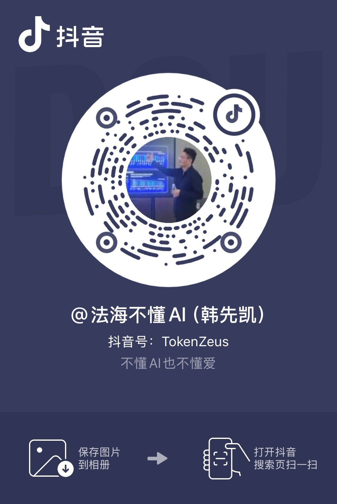

# 人生进阶指南

中文 | [English](en/)

**韩先凯 著**

**一个普通人的失败、恢复与重新学习。**

这不是一本教你怎么赢的书。它写一个普通人如何在公司倒闭、身体垮掉、关系受损之后，先把自己接住，再重新学习英语、使用 AI、做出作品，并把改变交给九十天和时间。

书里没有一条只向上的曲线。它有过失败、失眠、回老家、看医生和道歉；也有过重新读一页书、写一段话、做出一个能交付的小东西。所谓进阶，很多时候只是把地面扫干净，把该说的话说出来，把今天能完成的那一步完成。

**这本书是什么：** 一部以恢复为主线的中英双语书稿，一套可以复测的学习方法，一组可复制的工作表，以及一条从五分钟起步、按章节复测、九十天回望的实践路径。

**这本书不是什么：** 不是成功学，不是心理治疗或医疗建议，也不是一份要求你打卡完成的课程。

  第一版 1.1.0 · 持续更新
  <a href="./book-downloads">下载中心</a>
  <a href="./public/downloads/life-level-up-guide-zh.epub" download>下载中文 EPUB</a>
  <a href="./public/downloads/life-level-up-guide-en.epub" download>Download English EPUB</a>
  <a href="./public/downloads/life-level-up-guide-zh.pdf" download>下载中文 PDF</a>
  <a href="./public/downloads/life-level-up-guide-en.pdf" download>Download English PDF</a>
  <a href="https://github.com/byoungd/up">源码与勘误</a>
  <a href="./templates/reader-field-note">读者实践回执</a>
  <a href="https://github.com/byoungd/up/blob/main/CITATION.cff">引用格式</a>
  <a href="https://creativecommons.org/licenses/by-nc/4.0/">正文 CC BY-NC 4.0</a>

  

    从这里开始
    <h2 id="quick-start-title">先选一个入口，不必把整本书搬进今天</h2>
    
第一次来，选一个与你此刻最接近的入口，做完一件小事，让结果替你指出下一页。

  

  

    <a class="quick-start-action" href="./threads/part-0/prologue"><strong>先读序章：从一次坠落写起</strong>2022 年的火锅店、冻住的银行卡和回老家之后的那间房，是这本书真正的起点。</a>
    <a class="quick-start-action" href="./threads/part-2/my-story"><strong>先读我的故事</strong>公司倒闭、身体失控、关系受损，以及回家之后如何重新开始。</a>
    <a class="quick-start-action" href="./reference/reading-map"><strong>按眼前的问题进入</strong>七个入口：重新开始、练一项英语能力、海外岗位、资料没有作品、记录没有变化、帮助孩子、容量很小。</a>
  

  
想走完一个周期？从 <a href="./templates/90-day-cycle">九十日行动总表</a>开始，把一次练习带进真实项目和生活。

## 这本书适合谁

- 想重新开始，却不知道从哪一页起步的人；
- 需要用英语完成真实任务的自学者，而不是只想要一份考级攻略的人；
- 正在使用 AI 做真实工作，又不想把判断、来源和隐私一起交出去的人；
- 经历了失败、中断或长期低谷，想先把自己接住的人；
- 想陪孩子学习，又不想把成人的节奏强加给他的家长和老师。

如果你正在寻找速成公式、完整英语课程或临床治疗建议，这本书可能不是最合适的入口。完整的判断和边界写在[这本书适合谁，不适合谁](./threads/part-0/for-whom)。

## 书稿怎样展开

全书按一条可以往返的路线展开：先接住自己，再重新学习，然后借工具放大能力，最后把改变交给时间。

| 部分 | 这一部要追问什么 | 代表入口 |
| --- | --- | --- |
| 序章与如何读 | 我从哪里进入，又为什么愿意重新开始？ | [序章](./threads/part-0/prologue) · [如何读这本书](./threads/part-0/reader-guide) |
| 第一部：把自己放回生活 | 失败、身体、关系、事业与选择，怎样重新放进同一段人生？ | [本部导语](./threads/part-2/return-to-life) · [我的故事](./threads/part-2/my-story) |
| 第二部：重新学习，打开输入 | 怎样用英语这个具体的训练场，重新建立学习能力？ | [本部导语](./threads/part-1/open-input) · [CEFR 自测](./threads/part-1/0-cefr) |
| 第三部：借工具放大能力 | 怎样使用 AI，又不把注意力和判断力一起外包？ | [使用 AI 学习一切](./threads/part-3/1-ai-learning) · [证据篇](./threads/part-3/5-evidence-and-transfer) |
| 第四部：实践与恢复 | 怎样让学习回到身体、家庭和日常？ | [本部导语](./threads/part-4/practice-and-recovery) · [第一周实践](./threads/part-4/week-1) |
| 第五部：行动与长期改变 | 怎样把一轮练习带进真实项目，并让九十天以后仍有回声？ | [本部导语](./threads/part-5/long-term-action) · [九十天行动篇](./threads/part-5/90-day-plan) |
| 第六部与后记 | 怎样了解、善待、提升自己，并与自己长期相处？ | [与自己做终身朋友](./threads/part-6/1-understanding-yourself) · [后记](./threads/part-6/afterword) |

术语不清时，可以查[术语与方法索引](./reference/glossary)；想按一个问题直接进入，打开[阅读地图](./reference/reading-map)；全书的结构与三条阅读路径见[本书路线图](./threads/part-0/roadmap)。

## 把一页书带回今天

终身学习不是同时打开十门课程，而是让一页文字在今天变成一个小小的现实：

1. **写下眼前的问题。** 在[学习状态](./templates/learning-state)里记下你已经知道什么、还缺什么、什么算完成；若问题关乎生活容量、关系或恢复，也可以使用[生活进阶工作表](./templates/life-practice-toolkit)。
2. **完成一个能被看见的动作。** 让 AI 帮你拆解，但亲自核对来源、做出选择，留下笔记、代码、录音、邮件、反馈或其他真实输出，而不只保存聊天记录。
3. **回来看看它是否真的带走了什么。** 按章节的训练周期做复测，再用[每周复盘](./templates/weekly-review)或[九十日行动总表](./templates/90-day-cycle)判断下一步是否值得继续。

如果发现错误、翻译差异或可复现的实践结果，欢迎通过 [Issue 模板](https://github.com/byoungd/up/issues/new/choose)告诉我们；如果这份指南让你完成了一件真实的事，也欢迎 [Star 本仓库](https://github.com/byoungd/up)，让更多学习者找到它。

## 写给仍在路上的人

### 写给年轻人

你不必在二十几岁就找到一个永远正确的方向。很多方向不是想清楚之后才出现，而是在做过几个小项目、见过几种工作、承担过几次结果之后，才慢慢从雾里显形。比选中完美赛道更可靠的，是保留学习、交付和转向的能力。

如果职业焦虑让你不停收藏课程、证书和成功故事，不妨换成一个两周可以结束的小项目：解决身边人的一个问题，做出一个能运行的工具，写完一篇有来源的文章，或为真实用户改进一次流程。项目可以失败，但它会告诉你喜欢什么、缺少什么、能否交付，以及别人是否愿意再次使用。

### 写给正在低谷中的人

失业、创业失败、关系结束、健康受损和长时间的迷茫，都会真实地削弱精力。低谷不是一场必须立刻赢下来的考试。今天能做的，也许只是睡一晚相对完整的觉、吃一顿饭、走到户外，或向一个可信的人说“我现在需要帮助”。这些事情本身就有意义，不必先把它们包装成一份成长报告。

暂停不是放弃，求助不是软弱，重新校准也不是退步。等力量回来，再决定要不要增加重量。这里的个人故事不是医疗或心理治疗建议；如果低落、失眠、绝望或危险念头持续存在，请联系可信亲友，并寻求当地具备资质的医疗或心理专业支持。先保证安全，再谈成长。

## 作者与现实实践

我叫韩先凯。这个项目在 2017 年从《离谱的英语学习指南》开始，后来进入学习、开发、企业服务、创业验证和真实生活。书里的方法会被放进这些场景里检验，但身份、商业关系、能力与收入结果都写在明处，只接受作品、用户、成本和时间留下的证据。

方法只有进入生活，才知道自己是否站得住。关系会结束，也可能重新开始；工作会改变，学习会在与真实的人相遇时获得新的意义。

参与的产品、公司参访与现实项目统一放在[作者项目与现实实践](./projects)，页面会标明作者关联、用途、更新时间和非赞助关系。第三方入口集中放在[资源目录](./resources)，那里说明它们只是可选资源，不等于本书或作者对其安全、质量与合规性的背书。

  <figure class="latest-update">
    
    <figcaption><strong>四婚婚礼合影</strong>这张照片记录了韩先凯的第四次婚礼。爱情与婚姻的感悟：爱不只是一时的心动，也是在日常里持续选择、尊重、承担与共同成长。</figcaption>
  </figure>
  <figure class="latest-update">
    
    <figcaption><strong>走进阿里巴巴</strong>我到阿里巴巴参观考察，在现场了解千问大模型的展示。</figcaption>
  </figure>

### 在抖音继续看

扫码关注抖音账号 **法海韩先凯（抖音号：72581209403）**，获取英语训练、AI 协作、真实项目和人生进阶的短内容。二维码只提供公开账号关注入口；本站不接入广告、分析脚本或追踪器，也不会因为关注二维码收集站点访问数据。无法扫码时，可在抖音搜索“法海韩先凯”或抖音号 `72581209403`。

<figure class="author-social-card">
  
  <figcaption>作者提供的公开账号二维码；图片元数据已清理。</figcaption>
</figure>

## 阅读、下载与共同修订

- 本项目是开放内容项目，不是 OSI 意义上的开源软件：正文与作者内容采用 **CC BY-NC 4.0**，站点配置、检查脚本和构建代码采用 **MIT**。详见[许可证说明](https://github.com/byoungd/up/blob/main/LICENSE.md)。
- 引用、图片和第三方素材的来源及授权状态记录在[第三方素材与引用](https://github.com/byoungd/up/blob/main/ATTRIBUTIONS.md)；完整的参考资料见附录[参考文献](./reference/bibliography)。
- 贡献前请阅读[贡献指南](https://github.com/byoungd/up/blob/main/CONTRIBUTING.md)、[中文贡献指南](https://github.com/byoungd/up/blob/main/CONTRIBUTING.zh-CN.md)和[行为准则](https://github.com/byoungd/up/blob/main/CODE_OF_CONDUCT.md)。
- 产品与服务条目的核验日期以各自页面和[第三方素材与引用](https://github.com/byoungd/up/blob/main/ATTRIBUTIONS.md)中的记录为准；产品能力、可用性与合规范围仍以官方页面、正式协议和实际验收为准。

在线阅读：[GitHub Pages](https://byoungd.github.io/up/) · [GitHub 仓库](https://github.com/byoungd/up) · 英文版：[Still Here: A Field Guide to Beginning Again](en/)。

如果今天只做一件事，就创建一份[学习状态](./templates/learning-state)，写下正在面对的问题、手边已有的线索和下一项最小任务。不要等道路变得宽阔才出发；很多路，正是在脚落下之后才显现。
