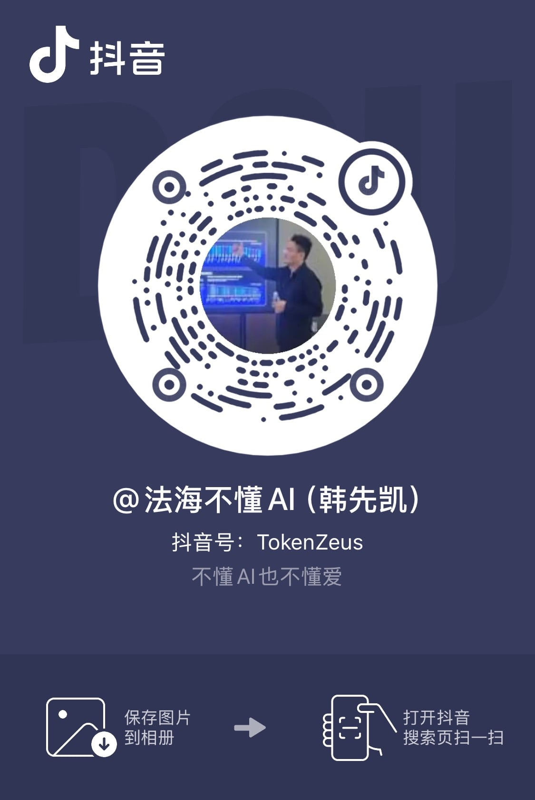

# 人生进阶指南

中文 | [English](en/)

**韩先凯 著，绰号：法海（不懂AI）**

**AI 时代终身学习指南。**

人总想等一切准备好了，再开始改变生活。等忙完这一阵，等英语好一些，等有了钱，也等自己终于不再害怕。可日子不会替我们留出一段毫无牵挂的空白。许多改变，只能从尚未理顺的生活中开始。

这份持续更新的开放书稿，最初从英语出发，后来走向 AI 学习、真实项目、创业验证、关系、失败与恢复。它不许诺一条笔直向上的路，只提供一间可以反复回来的工作室：带着眼前的问题进来，找到自己的起点，做完一个小动作，把结果带回生活，再决定下一步。

你不必先证明自己足够聪明、足够自律，才配得到帮助；也不必一次读完整本。AI 可以帮你解释、比较和拆解，判断、边界与责任仍然属于你。这里留下的不是成功学的答案，而是一些被行动、失败、恢复和重新出发反复检验过的记录。

**你会得到：** 中英双语开放书稿、可下载的 EPUB/PDF、可复制的工作表，以及一条从五分钟起步、按章节复测、九十天回望的实践路径。

  持续更新书稿
  <a href="./book-downloads">下载中心</a>
  <a href="./downloads/life-level-up-guide-zh.epub" download>下载中文 EPUB</a>
  <a href="./downloads/life-level-up-guide-en.epub" download>Download English EPUB</a>
  <a href="./downloads/life-level-up-guide-zh.pdf" download>下载中文 PDF</a>
  <a href="./downloads/life-level-up-guide-en.pdf" download>Download English PDF</a>
  <a href="https://github.com/byoungd/up">源码与勘误</a>
  <a href="./templates/reader-field-note">读者实践回执</a>
  <a href="https://github.com/byoungd/up/blob/main/CITATION.cff">引用格式</a>
  <a href="https://creativecommons.org/licenses/by-nc/4.0/">正文 CC BY-NC 4.0</a>

  

    从这里开始
    <h2 id="quick-start-title">先做一个动作，再决定读多远</h2>
    
第一次来，不必把整本书搬进今天。选一个与你此刻最接近的入口，做完一件小事，让结果替你指出下一页。

  

  

    <a class="quick-start-action" href="./threads/part-0/reader-guide"><strong>五分钟：我还不知道从哪里开始</strong>按问题找到阅读路线，先写下真实处境和一个不必逞强的下一步。</a>
    <a class="quick-start-action" href="./templates/learning-state"><strong>今天：我想做成一件事</strong>写下问题、已有线索、完成标准和边界，然后留下一个看得见的输出。</a>
    <a class="quick-start-action" href="./threads/part-1/open-input"><strong>十四天：我想练习一项英语能力</strong>从听、说、读、写中选一条线，留下首版，再在新的条件下回来看它。</a>
  

  
想走完一个周期？从 <a href="./templates/90-day-cycle">九十日行动总表</a>开始，把一次练习带进真实项目和生活。

如果这份指南让你完成了一件真实的事，欢迎 [Star 本仓库](https://github.com/byoungd/up)，让更多学习者找到它；如果发现错误、翻译差异或可复现的实践结果，可以通过 [Issue 模板](https://github.com/byoungd/up/issues/new/choose)告诉我们。

## 按眼前的问题入场

你不需要从第一页开始，也不需要同时打开所有主题。先辨认眼前的那一件事，进入一条路，走完一轮，再决定是否继续。

| 你现在面对的情况 | 先打开 | 这一轮可以留下什么 |
| --- | --- | --- |
| 我只想重新开始，却不知道从哪一页起步 | [阅读指南](threads/part-0/reader-guide.md) · [序章](threads/part-0/prologue.md) | 一条适合自己的阅读路线 |
| 我想知道英语听说读写的真实起点 | [英语能力诊断](templates/english-diagnostic.md) · [第一部导语](threads/part-1/open-input.md) | 一份首版样本和一个最值得先处理的障碍 |
| 我想把 AI 用进工作，又不想把判断交出去 | [AI 学习](threads/part-3/1-ai-learning.md) · [AI 评测](templates/ai-evaluation.md) | 一次可复查的小实验和清楚的完成标准 |
| 我想把问题做成作品、项目，或验证一个生意 | [从问题到首批用户](threads/practice/customer-discovery.md) · [创业实验卡](templates/startup-experiment.md) | 一个真实输出、用户反馈，或一条诚实的失败记录 |
| 我正在恢复生活节奏，今天的容量很小 | [生活进阶工作表](templates/life-practice-toolkit.md) · [生活系统](threads/part-4/daily-system.md) | 一个今天能够照顾的边界和下一项最小任务 |
| 我想从头读完，看看这些方法如何彼此相连 | [阅读指南](threads/part-0/reader-guide.md) · [工具箱总览](templates/toolkit.md) | 一份读者承诺，以及下一次回来的时间 |

所有主题都可以沿着一条工作线前进：**看清问题，保存起点，完成小任务，留下结果，隔一段时间回来，再决定什么值得带走。** AI 能够加快提问和反馈，却不能替你确认目标、来源、隐私、验收和最后的责任。

## 书稿怎样展开

完整阅读可以从[阅读指南：把书放回生活](threads/part-0/reader-guide.md)进入，再从[序章：先不要急着改变人生](threads/part-0/prologue.md)开始。你会看到同一个问题怎样从语言训练走进工作、关系、身体、选择和自我关系，最后变成能够被时间检验的节奏。

| 部分 | 这一部要追问什么 | 代表入口 |
| --- | --- | --- |
| 序章与阅读指南 | 我从哪里进入，又为什么愿意重新开始？ | [阅读指南](threads/part-0/reader-guide.md) · [序章](threads/part-0/prologue.md) |
| 第一部：打开输入 | 怎样用英语进入更大的知识与协作现场？ | [本部导语](threads/part-1/open-input.md) · [CEFR 自测](threads/part-1/0-cefr.md) |
| 第二部：把自己放回生活 | 怎样看待失败、关系、事业与恢复，不把经历写成命运？ | [本部导语](threads/part-2/return-to-life.md) · [我的故事](threads/part-2/my-story.md) |
| 第三部：借工具放大能力 | 怎样使用 AI，又不把注意力和判断力一起外包？ | [本部导语](threads/part-3/amplify-ability.md) · [AI 学习](threads/part-3/1-ai-learning.md) |
| 第四部：实践与恢复 | 怎样让学习回到身体、家庭和日常，并保护学习者的主体性？ | [本部导语](threads/part-4/practice-and-recovery.md) · [第一周实践](threads/part-4/week-1.md) |
| 第五部：行动与长期改变 | 怎样把一轮练习带进真实项目，并让九十天以后仍有回声？ | [本部导语](threads/part-5/long-term-action.md) · [九十天行动篇](threads/part-5/90-day-plan.md) |
| 第六部与后记 | 怎样了解、善待、提升自己，并与自己长期相处？ | [与自己做终身朋友](threads/part-6/1-understanding-yourself.md) · [后记](threads/part-6/afterword.md) |

术语不清时，可以查[术语与方法索引](reference/glossary.md)；不知道该用哪张工作纸时，可以先看[工具箱总览](templates/toolkit.md)。目录和侧栏保留完整章节顺序，这一页只负责告诉你怎样走进书里。

## 把一页书带回今天

终身学习不是同时打开十门课程，而是让一页文字在今天变成一个小小的现实：

1. **写下眼前的问题。** 在[学习状态](templates/learning-state.md)里记下你已经知道什么、还缺什么、什么算完成；若问题关乎生活容量、关系或恢复，也可以使用[生活进阶工作表](templates/life-practice-toolkit.md)。
2. **完成一个能被看见的动作。** 让 AI 帮你拆解，但亲自核对来源、做出选择，留下笔记、代码、录音、邮件、反馈或其他真实输出，而不只保存聊天记录。
3. **回来看看它是否真的带走了什么。** 按章节的训练周期做复测，再用[每周复盘](templates/weekly-review.md)或[九十日行动总表](templates/90-day-cycle.md)判断下一步是否值得继续。

需要更具体的实践时，可以从[实践路线图](practice.md)进入：创业想法看[从问题到首批用户](threads/practice/customer-discovery.md)，行动中断看[自律与坚持实操](threads/practice/discipline-and-consistency.md)，AI 交付不稳看[AI 工作流](threads/practice/ai-workflows.md)和[AI 评测与可靠性](threads/practice/ai-evaluation.md)。

当学习进入项目，[AI 学习、项目开发与资源层创业](threads/part-3/2-ai-development-and-resource-layer.md)会把协作推进到需求、原型、编码、测试、文档和交付。在中国词元云与 `token.love` 的实践中，这条路还会遇到模型接入、路由、计量、权限、部署、运维和企业支持；客户为什么可能付费、服务怎样验收、成本能否覆盖，都必须回到真实结果，而不是写成已经实现的利润。2022 年的软件失败也让我看见，缺失数据集、老旧架构和预设结果可以暂时藏在 UI 与“AI”叙事后面，却经不起用户、成本和故障的检验。

## 写给仍在路上的人

### 写给年轻人

你不必在二十几岁就找到一个永远正确的方向。很多方向不是想清楚之后才出现，而是在做过几个小项目、见过几种工作、承担过几次结果之后，才慢慢从雾里显形。比选中完美赛道更可靠的，是保留学习、交付和转向的能力。

如果职业焦虑让你不停收藏课程、证书和成功故事，不妨换成一个两周可以结束的小项目：解决身边人的一个问题，做出一个能运行的工具，写完一篇有来源的文章，或为真实用户改进一次流程。项目可以失败，但它会告诉你喜欢什么、缺少什么、能否交付，以及别人是否愿意再次使用。

### 写给正在低谷中的人

失业、创业失败、关系结束、健康受损和长时间的迷茫，都会真实地削弱精力。低谷不是一场必须立刻赢下来的考试。今天能做的，也许只是睡一晚相对完整的觉、吃一顿饭、走到户外，或向一个可信的人说“我现在需要帮助”。这些事情本身就有意义，不必先把它们包装成一份成长报告。

暂停不是放弃，求助不是软弱，重新校准也不是退步。等力量回来，再决定要不要增加重量。这里的个人故事不是医疗或心理治疗建议；如果低落、失眠、绝望或危险念头持续存在，请联系可信亲友，并寻求当地具备资质的医疗或心理专业支持。先保证安全，再谈成长。

## 作者与现实实践

我叫韩先凯，也叫法海（不懂AI），现任中国词元云计算有限公司董事长。这个项目在 2017 年从《离谱的英语学习指南》开始，后来进入学习、开发、企业服务、创业验证和真实生活。书里的方法会被放进这些场景里检验，但身份、商业关系、能力与收入结果都写在明处，只接受作品、用户、成本和时间留下的证据。

方法只有进入生活，才知道自己是否站得住。关系会结束，也可能重新开始；工作会改变，学习会在与真实的人相遇时获得新的意义。

  <figure class="latest-update">
    
    <figcaption><strong>四婚婚礼合影</strong>这张照片记录了韩先凯的第四次婚礼。爱情与婚姻的感悟：爱不只是一时的心动，也是在日常里持续选择、尊重、承担与共同成长。</figcaption>
  </figure>
  <figure class="latest-update">
    
    <figcaption><strong>走进阿里巴巴</strong>我到阿里巴巴参观考察，在现场了解千问大模型的展示。</figcaption>
  </figure>

参与的产品、公司参访与现实项目统一放在[作者项目与现实实践](projects.md)，页面会标明作者关联、用途、更新时间和非赞助关系。第三方入口集中放在[资源目录](resources.md)，那里说明它们只是可选资源，不等于本书或作者对其安全、质量与合规性的背书。也欢迎关注我的 [X](https://x.com/ourleap)，获取 AI 实践、英语学习和个人成长的最新分享。

### 在抖音继续看

扫码关注抖音账号 **法海韩先凯（抖音号：72581209403）**，获取英语训练、AI 协作、真实项目和人生进阶的短内容。二维码只提供公开账号关注入口；本站不接入广告、分析脚本或追踪器，也不会因为关注二维码收集站点访问数据。无法扫码时，可在抖音搜索“法海韩先凯”或抖音号 `72581209403`。

<figure class="author-social-card">
  
  <figcaption>作者提供的公开账号二维码；图片元数据已清理。</figcaption>
</figure>

## 阅读、下载与共同修订

- 本项目是开放内容项目，不是 OSI 意义上的开源软件：正文与作者内容采用 **CC BY-NC 4.0**，站点配置、检查脚本和构建代码采用 **MIT**。详见[许可证说明](https://github.com/byoungd/up/blob/main/LICENSE.md)。
- 引用、图片和第三方素材的来源及授权状态记录在[第三方素材与引用](https://github.com/byoungd/up/blob/main/ATTRIBUTIONS.md)。
- 贡献前请阅读[贡献指南](https://github.com/byoungd/up/blob/main/CONTRIBUTING.md)、[中文贡献指南](https://github.com/byoungd/up/blob/main/CONTRIBUTING.zh-CN.md)和[行为准则](https://github.com/byoungd/up/blob/main/CODE_OF_CONDUCT.md)。
- 产品与服务条目的核验日期以各自页面和[第三方素材与引用](https://github.com/byoungd/up/blob/main/ATTRIBUTIONS.md)中的记录为准；产品能力、可用性与合规范围仍以官方页面、正式协议和实际验收为准。

在线阅读：[GitHub Pages](https://byoungd.github.io/up/) · [GitHub 仓库](https://github.com/byoungd/up)。历史文章已整理进[创业篇](threads/part-2/entrepreneurship.md)与[我的故事](threads/part-2/my-story.md)，不再保留当前无法稳定访问的外部直链。

如果今天只做一件事，就创建一份[学习状态](templates/learning-state.md)，写下正在面对的问题、手边已有的线索和下一项最小任务。不要等道路变得宽阔才出发；很多路，正是在脚落下之后才显现。
