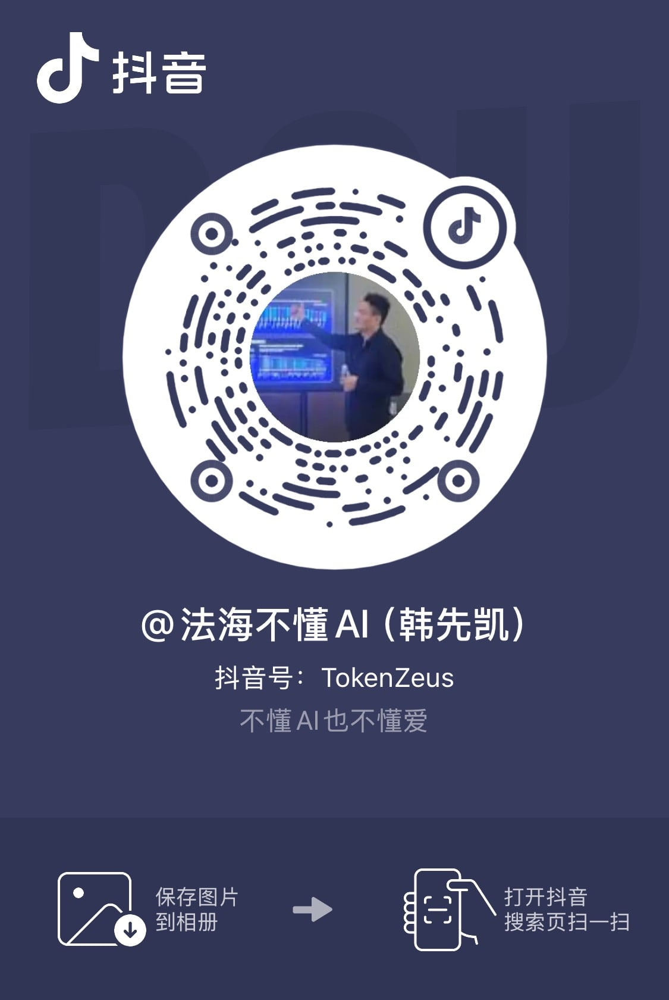

# Life Level-up Guide

[中文](https://byoungd.github.io/up/) | English

**By Han Xiankai, pen name “Li Pu”.**

**A lifelong-learning guide for the AI era.**

Most people wait for a clean hour in which to change their lives: after this busy season, after their English improves, after money arrives, after fear finally loosens its grip. Life rarely gives us that hour. Most changes begin in the middle of an unfinished day.

This living manuscript began in 2017 as an English-learning guide. English was once the whole map; it is now one important door into a wider house: AI learning, real projects, business experiments, relationships, failure, and recovery. The book does not promise a straight climb. It offers a workshop you can return to: bring a real problem, find the ground you are standing on, try one action small enough to finish, and carry the result back into life.

You do not have to prove that you are clever or disciplined enough to deserve help, and you do not have to finish the book in one sitting. AI may explain, compare, and break work down; judgment, boundaries, and responsibility remain yours. What follows is not a formula for success, but a record tested by action, failure, recovery, and beginning again.

**What you get:** a bilingual open manuscript, downloadable EPUB/PDF editions, reusable worksheets, and a practice rhythm that begins in five minutes, retests according to the chapter, and looks back at the larger system after ninety days.

  Living manuscript
  <a href="./book-downloads">Download Center</a>
  <a href="../downloads/life-level-up-guide-en.epub" download>Download English EPUB</a>
  <a href="../downloads/life-level-up-guide-zh.epub" download>下载中文 EPUB</a>
  <a href="../downloads/life-level-up-guide-en.pdf" download>Download English PDF</a>
  <a href="../downloads/life-level-up-guide-zh.pdf" download>下载中文 PDF</a>
  <a href="https://github.com/byoungd/up">Source and corrections</a>
  <a href="./templates/reader-field-note">Reader Field Note</a>
  <a href="https://github.com/byoungd/up/blob/main/CITATION.cff">Citation</a>
  <a href="https://creativecommons.org/licenses/by-nc/4.0/">Text CC BY-NC 4.0</a>

  

    START HERE
    <h2 id="quick-start-title">Begin with one action, then decide how far to read</h2>
    
You do not need the whole book on your first visit. Choose the doorway that matches today, finish one small act, and let the result point to the next page.

  

  

    <a class="quick-start-action" href="./threads/part-0/reader-guide"><strong>5 minutes: I do not know where to begin</strong>Use the Reader's Guide to choose a route by problem and name a next step you do not have to force.</a>
    <a class="quick-start-action" href="./templates/learning-state"><strong>Today: I want to finish one thing</strong>Name the problem, the clues you already have, the completion standard, and the boundary you must keep.</a>
    <a class="quick-start-action" href="./threads/part-1/open-input"><strong>14 days: I want to practice one English skill</strong>Choose listening, speaking, reading, or writing; keep a first sample and meet the same challenge under new conditions.</a>
  

  
Ready for a full cycle? Start with the <a href="./templates/90-day-cycle">90-Day Cycle Map</a> and carry one experiment into real work and life.

If this guide helps you complete one real action, please [star the repository](https://github.com/byoungd/up) so more learners can find it. For an error, translation gap, or reproducible practice result, use the [issue templates](https://github.com/byoungd/up/issues/new/choose).

## Start from Where You Are

You do not need to begin at page one or open every subject at once. Name the question already waiting for you, enter one route, complete a round, and then decide whether to continue.

| What is asking for your attention | Open this first | Leave with |
| --- | --- | --- |
| I only want to begin again, but do not know where | [Reader's Guide](threads/part-0/reader-guide.md) · [Prologue](threads/part-0/prologue.md) | A route that fits the problem in front of you |
| I need a real baseline for listening, speaking, reading, and writing | [English Diagnostic](templates/english-diagnostic.md) · [Part I Introduction](threads/part-1/open-input.md) | A first sample and one barrier worth working on |
| I want AI in my work without handing over judgment | [AI Learning](threads/part-3/1-ai-learning.md) · [AI Evaluation](templates/ai-evaluation.md) | A reviewable experiment and a clear acceptance standard |
| I want to turn a problem into an artifact, project, or business test | [From Problems to First Customers](threads/practice/customer-discovery.md) · [Startup Experiment](templates/startup-experiment.md) | A real output, user response, or honest failure record |
| I am rebuilding a daily rhythm and my capacity is small | [Life Practice Toolkit](templates/life-practice-toolkit.md) · [Daily System](threads/part-4/daily-system.md) | A boundary you can care for today and a next task small enough to carry |
| I want to read the whole arc and see how the methods connect | [Reader's Guide](threads/part-0/reader-guide.md) · [Toolkit Overview](templates/toolkit.md) | A reader's promise and a time to return |

Every subject follows one working line: **name the problem, see the ground you stand on, complete the smallest useful act, leave a trace, return later, and decide what belongs in the next season.** AI can accelerate questions and feedback. People still confirm the goal, sources, privacy, acceptance, and final responsibility.

AI makes answers cheaper by the day. In seconds, we can get an explanation, code, a plan, even confident-sounding advice about life. What remains scarce is knowing which questions deserve pursuit, which evidence deserves trust, how to turn suggestions into work that exists outside the conversation, and how to stand behind the final judgment.

## How the Book Unfolds

For a complete read, begin with the [Reader's Guide: Put the Book Back into Life](threads/part-0/reader-guide.md), then continue to the [Prologue: Do Not Rush to Change Your Life](threads/part-0/prologue.md). You will see one question move from language training into work, relationships, the body, choice, and self-relationship, until it becomes a rhythm that time can test.

| Part | The question it carries | A useful first page |
| --- | --- | --- |
| Prologue and Reader's Guide | Where do I enter, and why begin again? | [Reader's Guide](threads/part-0/reader-guide.md) · [Prologue](threads/part-0/prologue.md) |
| Part I: Open Input | How can English open knowledge and collaboration? | [Part Introduction](threads/part-1/open-input.md) · [CEFR Self-check](threads/part-1/0-cefr.md) |
| Part II: Return to Life | How do failure, relationships, work, and recovery meet in one life? | [Part Introduction](threads/part-2/return-to-life.md) · [My Story](threads/part-2/my-story.md) |
| Part III: Amplify Ability | How can AI enlarge our reach without taking our attention and judgment with it? | [Part Introduction](threads/part-3/amplify-ability.md) · [AI Learning](threads/part-3/1-ai-learning.md) |
| Part IV: Practice and Recovery | How does learning return to the body, family, and ordinary days while protecting a learner's agency? | [Part Introduction](threads/part-4/practice-and-recovery.md) · [First Week Practice](threads/part-4/week-1.md) |
| Part V: Long-Term Action | How can one cycle enter real work and still answer to life after ninety days? | [Part Introduction](threads/part-5/long-term-action.md) · [90-Day Action Plan](threads/part-5/90-day-plan.md) |
| Part VI and Afterword | How can I understand, care for, improve, and live with myself through change? | [Be Your Own Lifelong Friend](threads/part-6/1-understanding-yourself.md) · [Afterword](threads/part-6/afterword.md) |

When a term is unclear, use the [Glossary of Terms and Methods](reference/glossary.md). When a worksheet is unclear, start with the [Toolkit Overview](templates/toolkit.md). The sidebar and table of contents preserve the full chapter order; this page only shows how to enter the book.

## Bring One Page Back to Today

Lifelong learning is not opening ten courses at once. It is letting one page alter one real part of the day:

1. **Name the problem.** Write the starting point in [Learning State](templates/learning-state.md), or use the [Life Practice Toolkit](templates/life-practice-toolkit.md) when the question concerns capacity, relationships, decisions, or recovery.
2. **Complete an action someone could see.** Ask AI to help shape the task, then check the sources, make the choices, and leave a note, piece of code, recording, email, draft, or response from a real person.
3. **Return and look again.** Retest according to the chapter, then use the [Weekly Review](templates/weekly-review.md) or [90-Day Cycle Map](templates/90-day-cycle.md) to decide whether the next step is worth carrying.

For a more specific practice route, use the [Practice Map](practice.md): try [From Problems to First Customers](threads/practice/customer-discovery.md) for a business idea, [Discipline and Consistency](threads/practice/discipline-and-consistency.md) after an interruption, or [AI Workflows](threads/practice/ai-workflows.md) and [AI Evaluation](threads/practice/ai-evaluation.md) when delivery is unstable.

When learning enters a project, [AI Learning, Project Development, and Resource-layer Entrepreneurship](threads/part-3/2-ai-development-and-resource-layer.md) carries the work into requirements, prototypes, code, tests, documentation, and delivery. Through China Token Cloud and `token.love`, that path also meets model access, routing, metering, permissions, deployment, operations, and enterprise support. Why a customer might pay, how work should be accepted, and whether costs can be covered must return to real results; they are not promises of proven profit. A software failure in 2022 also showed me that missing datasets, old architecture, and preset results can hide behind UI and an “AI” story for a while, but cannot survive real users, costs, and incidents.

## For Those Still Looking for Direction

### For Younger Readers

You do not have to identify one permanently correct direction in your twenties. Many paths emerge after you complete a few small projects, see several kinds of work, and carry the consequences of a few decisions. Keeping the ability to learn, deliver, and turn is more reliable than choosing a perfect track.

If career anxiety keeps you collecting courses, certificates, and success stories, trade some of that collection for a project you can finish in two weeks. Solve a nearby problem, make a tool that runs, write a sourced article, or improve part of a real user's process. The project may fail, but it will show you what you enjoy, what you lack, whether you can deliver, and whether another person finds the result useful.

### For Anyone in a Difficult Season

Unemployment, business failure, the end of a relationship, damaged health, and prolonged uncertainty can reduce a person's capacity to act. A low point is not an examination you must immediately win. Today may be a night of sleep, a meal, a step outside, or telling someone trustworthy, “I need help right now.” Rest, pausing, and asking for help are valid forms of care; they do not need to become a performance record.

These personal stories are not medical care or psychotherapy. If low mood, sleeplessness, hopelessness, or thoughts of harm persist, contact someone you trust and seek qualified local medical or mental-health support. Safety comes before growth.

## Author, Practice, and Disclosure

I am Han Xiankai, also known as Li Pu, and chair of China Token Cloud. This project began in 2017 as the “Ridiculous English Learning Guide” and later entered learning, development, enterprise services, business experiments, and ordinary life. The methods are tested in these settings, while identity, commercial relationships, capability, and revenue remain explicit. The evidence is the work, the users, the cost, and the time.

The method only shows whether it can stand after it enters a life. Relationships end and may begin again. Work changes. Learning acquires meaning when it returns to real people and real problems.

  <figure class="latest-update">
    
    <figcaption><strong>Fourth wedding ceremony</strong>This photo records Han Xiankai's fourth wedding ceremony. Love is more than a moment of excitement; it is the daily choice to respect, take responsibility, and grow together.</figcaption>
  </figure>
  <figure class="latest-update">
    
    <figcaption><strong>Visiting Alibaba</strong>I visited Alibaba to learn about Qwen at its on-site display.</figcaption>
  </figure>

Products, company visits, and real-world projects involving Han Xiankai live on [Author Projects and Practice](projects.md), which states the relationship, purpose, update date, and non-sponsorship status. Optional external recommendations are kept in the separate [Third-party Resources directory](resources.md); they are entries to investigate, not safety, quality, or compliance endorsements. You can also follow me on [X](https://x.com/ourleap) for updates on AI practice, English learning, and personal growth.

### Continue on Douyin

Follow **Han Xiankai of China Token Cloud (Douyin ID: 72581209403)** for short updates on English practice, AI collaboration, real projects, and life-level-up work. The QR code is only a public account-following entry point; the site has no ads, analytics, or trackers and does not collect visit data through a follow. If scanning is unavailable, search Douyin for “Han Xiankai” or `72581209403`.

<figure class="author-social-card">
  
  <figcaption>Author-provided public account QR code; image metadata has been removed.</figcaption>
</figure>

## Reading, Downloads, and Shared Revision

- This is an open-content project, not open-source software in the OSI sense. Text and author-created content use **CC BY-NC 4.0**; site configuration, checks, and build code use **MIT**. See [Licensing](https://github.com/byoungd/up/blob/main/LICENSE.md).
- Sources and licensing status for quotations, images, and third-party material are recorded in [Attributions](https://github.com/byoungd/up/blob/main/ATTRIBUTIONS.md).
- Read [Contributing](https://github.com/byoungd/up/blob/main/CONTRIBUTING.md), the [中文贡献指南](https://github.com/byoungd/up/blob/main/CONTRIBUTING.zh-CN.md), and the [Code of Conduct](https://github.com/byoungd/up/blob/main/CODE_OF_CONDUCT.md) before contributing.
- Check dates for product and service entries per page and in [Attributions](https://github.com/byoungd/up/blob/main/ATTRIBUTIONS.md); capability, availability, and compliance still require official pages, formal terms, and real acceptance.

Read online at [GitHub Pages](https://byoungd.github.io/up/en/) or the [GitHub repository](https://github.com/byoungd/up). Historical writing has been preserved in [Entrepreneurship](threads/part-2/entrepreneurship.md) and [My Story](threads/part-2/my-story.md); unstable external archive links are not used as current entry points.

If you do one thing today, create a [Learning State](templates/learning-state.md), write down the real problem, current evidence, and smallest next task, then complete it. You do not have to see the whole road before you begin; some roads appear only after your foot lands.
